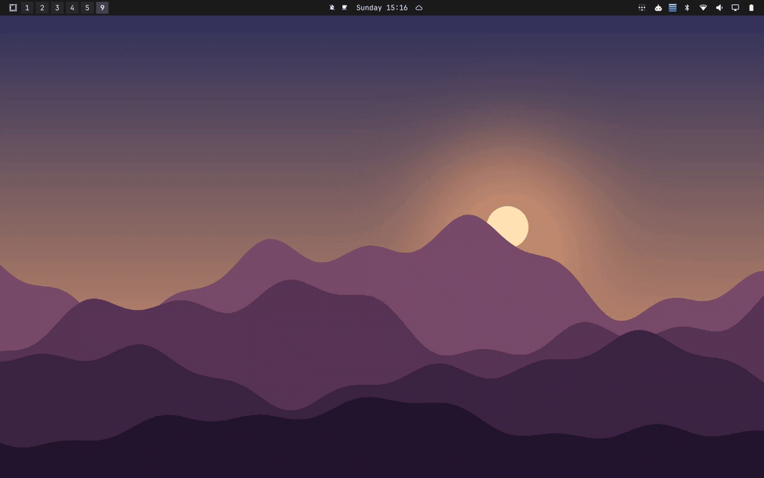

# Workspace Backgrounds

Every [Omarchy](https://omarchy.org) theme ships with a whole set of [backgrounds](https://omarchy.org/manual/backgrounds/), yet you only ever see one of them: every workspace looks the same, and the rest of the set waits in a folder. This plugin gives each workspace its own background. Switch workspaces and the background turns over with Omarchy's own reveal, so you know where you are before you read the bar -- and the whole set your theme came with finally gets used.



There is nothing to set up. Workspace N shows the theme's Nth background, and the controls you already know -- the background picker, `omarchy theme bg next`, switching themes -- keep working, now per workspace.

## Install

```bash
omarchy plugin add https://github.com/manyfold-dk/omarchy-workspace-backgrounds.git --enable
```

Omarchy shows you the URL and asks before it adds a plugin from git; see [Adding a plugin from git](https://omarchy.org/manual/shell-plugins/#adding-a-plugin-from-git) in the Omarchy manual. Enabling this plugin switches off the built-in background renderer, `omarchy.background`.

## How it behaves

| You | What happens |
|---|---|
| [Switch workspace](https://omarchy.org/manual/hotkeys/#navigating) | The background changes, with the same reveal transition Omarchy uses |
| Pick a background with [`Super + Ctrl + Space`](https://omarchy.org/manual/hotkeys/#style), run `omarchy theme bg next`, or run `omarchy theme bg set <image>` | Only the focused workspace changes, and it keeps that background until you switch theme |
| [Switch theme](https://omarchy.org/manual/themes/) | Per-workspace choices reset: workspace N shows the new theme's Nth background |
| Lock the screen | The lock screen shows the focused workspace's background |
| Use [several monitors](https://omarchy.org/manual/monitors/#arranging-multiple-screens) | Each monitor follows its own active workspace |

## Which backgrounds

The plugin uses the backgrounds `omarchy theme bg next` cycles through, in the same order: the theme's own `backgrounds/` folder plus your extras in `~/.config/omarchy/backgrounds/<theme>/`, sorted by file name. The [Backgrounds](https://omarchy.org/manual/backgrounds/) page of the manual shows how to add extras. Number prefixes (`1-...`, `2-...`) decide which workspace gets which. With more workspaces than backgrounds, the list wraps around: on a theme with four backgrounds, workspace 5 shows the first one again.

The plugin keeps its state in `~/.local/state/omarchy/workspace-backgrounds.json`: the theme it applies to and the backgrounds you picked per workspace. Omarchy's `~/.local/state/omarchy/current/background` link follows the focused workspace.

## Remove

```bash
omarchy plugin remove manyfold.workspace-backgrounds
rm -f ~/.local/state/omarchy/workspace-backgrounds.json
```

Removing the plugin switches the built-in background renderer back on. To keep the plugin installed but use the built-in renderer for a while, see [Turning them on and off](https://omarchy.org/manual/shell-plugins/#turning-them-on-and-off).

## Compatibility

- Omarchy Quattro (4.x) on Hyprland.
- Still images only: [video backgrounds](https://omarchy.org/manual/backgrounds/) are not supported, and an animated GIF shows its first frame.
- No dependencies beyond what Omarchy ships (`bash`, `find`, `ln`, `readlink`).

The plugin is derived from Omarchy's own [background plugin](https://github.com/omacom/omarchy/tree/quattro/shell/plugins/background) and keeps its IPC interface (`omarchy-shell background ...`), transitions and double-click actions. When Omarchy changes that plugin in a way this one has to follow, please open an issue.

## Development

The mapping rules live in `Model.js`, without QML, and are tested with plain Node:

```bash
node --test Model.test.mjs
omarchy plugin validate .
```

`Background.qml` is the renderer. Edits under `~/.config/omarchy/plugins/` normally reload on save; if the shell keeps running the old code, `omarchy restart shell` loads the new one. [Writing your own](https://omarchy.org/manual/shell-plugins/#writing-your-own) in the manual and the [shell reference](https://github.com/omacom/omarchy/blob/quattro/docs/omarchy-shell.md) cover the plugin interface.

## License

MIT -- see [LICENSE](LICENSE). Derived from Omarchy's background plugin, which is MIT-licensed by David Heinemeier Hansson. The demo GIF and the preview image are original artwork made for this repository, under the same license.
